# Autonomous Rover
**Wheeled Rover for a Collaborative Off-Road Robot Team**
 
L3Harris Heterogeneous Autonomous Vehicle Lab | Advisor: Dr. Sun | Role: Undergraduate Research Assistant

A 50 lb, 4-wheel skid-steer rover being built to drive autonomously on its own and as part of a heterogeneous robot team, including towing and being towed by other robots.

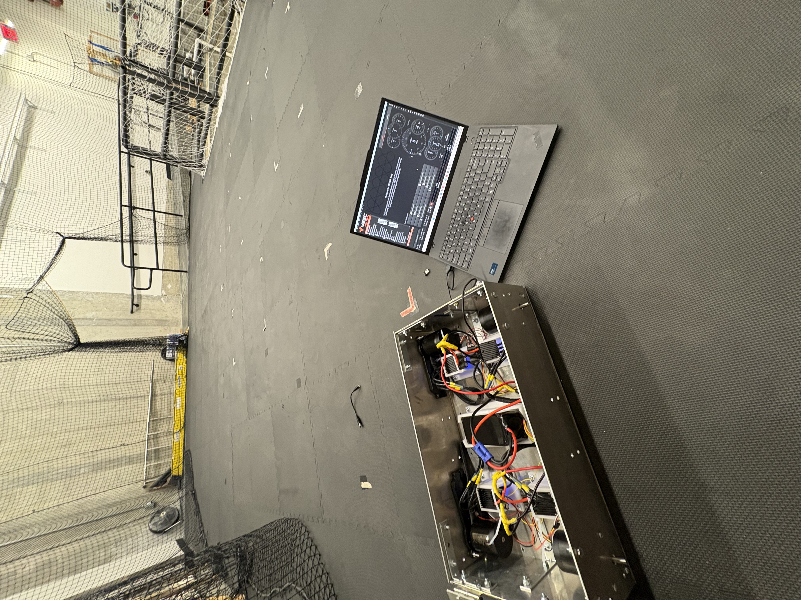

*Current build: fabricated chassis with drivetrain electronics installed.*

## Status at a Glance

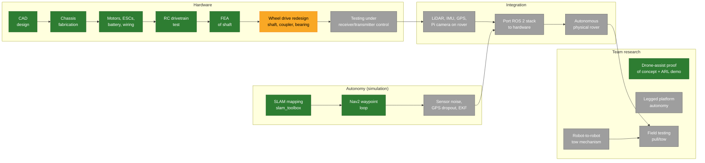

Green: complete. Yellow: in progress. Gray: planned.

## Key Results

- **Drone-assisted traction proof of concept:** a loaded wheeled robot that could not move regained motion once a drone lifted part of its weight. Presented a multi-robot coordination demo to the **U.S. Army Research Lab**.
- **Fabricated and tested drivetrain:** aluminum 6061-T6 chassis machined in-house; Flipsky 6374 motors and VESC ESCs configured and verified together under RC control.
- **Wheel drive redesign backed by fatigue analysis:** a direct motor-shaft wheel mount had a factor of safety of about 0.9. A coupler, separate drive shaft, and outboard support bearing raised it to about **3** under worst-case loading.
- **Simulated autonomy stack:** ROS 2 and Gazebo rover that builds a SLAM map from 2D lidar and runs a continuous figure-8 waypoint loop with Nav2.

## Demos

https://github.com/user-attachments/assets/157501a2-3318-4a4c-9c09-36679b82e03b

*Full drivetrain test: all motors driving together under transmitter control.*

https://github.com/user-attachments/assets/332fc901-cb11-4860-a606-da57c717b929

*Simulated rover running a continuous figure-8 Nav2 waypoint loop. Gazebo (left), RViz (right).*

## Next Steps

1. Install wheels with the drive shaft, coupler, and outboard bearing.
2. Validate the wheel drive: static side-load bench test, then powered on-stand run test.
3. Add sensor noise, GPS dropout, and EKF state estimation to the simulation.
4. Mount and integrate LiDAR, IMU, and GPS on the physical rover.
5. Port the ROS 2 navigation stack from simulation to hardware.

Longer term: Raspberry Pi optical detection, PWM-split ESC wiring, possible gear reduction, robot-to-robot connection mechanism, legged platform autonomy, and field testing of pull/tow capability.

---

## Background

This work is part of a broader research effort, **Autonomous Cyber-Physical Vehicle Coordination on Complex Terrains**. The idea is that a team of robots with different physical strengths can lean on each other to cross terrain that no single platform could handle alone.

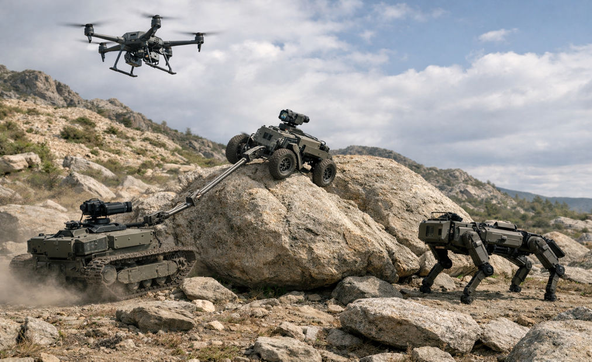

*Renderings of a heterogeneous robot team operating together.*

My role: build and autonomize the wheeled rover, extend that autonomy to a legged platform, and develop a mechanism that lets robots physically connect to push or pull each other autonomously.

**Proof of concept.** A wheeled robot under load, initially unable to move, regains traction once a drone lifts part of its weight, reducing static friction enough to drive forward. For this, I calibrated a RadioLink drone using ArduPilot and delivered the demo and presentation to the U.S. Army Research Lab.

https://github.com/user-attachments/assets/ae976bf7-49cf-4480-8de5-11d52da3f888

## Technical Details

### Design Requirements

Motor and material choices were driven by the pull and be-pulled requirement. Weight and torque calculations set the motor sizing needed to move the rover itself and tow another robot, and the CAD design was built around the resulting component list.

*CAD assembly with motors, wheels, and electronics.*

### Wheel Attachment Analysis

Driving the wheel directly off the motor shaft gave a factor of safety against shaft fatigue of about 0.9, at or below the failure threshold. The current design uses a coupler to a separate drive shaft with an outboard support bearing near the wheel. The bearing takes the bending load before it reaches the motor shaft or the motor's internal bearings, raising the factor of safety to about 3 under worst-case loading. The motor was disassembled to inspect its internals and characterize the load it could actually handle, rather than relying only on manufacturer specs.

### Bill of Materials

| Component | Role | Spec | Photo |
|---|---|---|---|
| Drive Motor | Wheel drive, sized for pull/tow load | Flipsky 6374, 140KV, current-limited to 15A |  |
| ESC | Motor speed control | FLIPSKY Mini V6 MK5, VESC 6.6, aluminum anodized heat sink |  |
| Battery | Power | Zeee 6S LiPo, 10000mAh, 22.2V, 120C, EC5 connector |  |
| Chassis Material | Structural frame | Aluminum 6061-T6 | 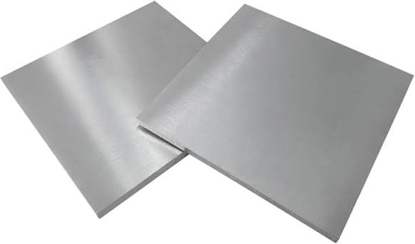 |
| Motor Mount | Secures motor to chassis | N63 Adjustable Motor Mount, 6374 Brushless Motor Holder |  |
| Wheels | Traction/mobility | 4.80/4.00-8 Pneumatic Wheelbarrow Tire, 16", 400 lb capacity | 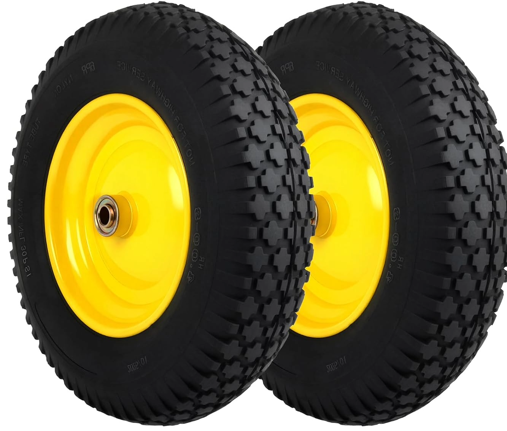 |
| Enclosure/Mount Material | 3D-printed battery/ESC mounts | PETG | 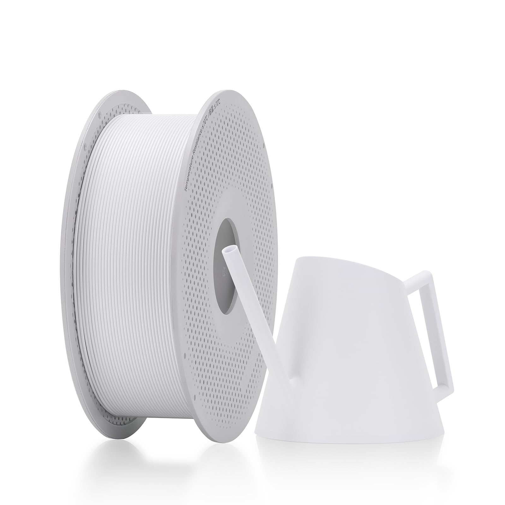 |
| Shaft Coupler | Connects the motor shaft to the drive shaft | |  |
| Drive Shaft | Transmits motor torque to the wheel | |  |
| Outboard Support Bearing | Supports the drive shaft near the wheel and carries bending load into the chassis | |  |
| Wiring | Motor/ESC power connections | 12 AWG wire, EC5 connectors |  |

### Autonomy Simulation

A ROS 2 and Gazebo simulation of a 4-wheel skid-steer rover, built to prototype the autonomy stack before the physical rover has wheels and lidar. Not yet deployed to hardware.

**What I built:** the rover model and world in SDF, the ROS-Gazebo bridge and launch files, a tuned Nav2 configuration, waypoint-loop and teleop scripts, and a one-command startup and shutdown system.

**Stack:** ROS 2 (Lyrical), Gazebo, slam_toolbox, Nav2, RViz, Python (rclpy).

**Simplifications:** noise-free Gazebo odometry and a fixed map-to-odom transform in place of AMCL localization, which is not representative of real hardware. Adding sensor noise, GPS dropout, and an EKF is the next step before porting to the physical rover.

https://github.com/user-attachments/assets/cc7eb8e0-4998-4710-9b85-dd4986cdbb55

*slam_toolbox building an occupancy grid from 2D lidar as the rover drives a walled room, visualized in RViz. The saved map is reused for navigation.*

The navigation loop uses a custom Python script that sends Nav2 waypoint goals continuously, switching to the next waypoint as the rover approaches the current one so motion stays smooth instead of stopping at each point.

---

## Build Log

### Fabrication

Fabricated in Villanova's machine shop using an angle grinder, drill press, lathe, 3D printer (PETG), and soldering iron. Lock nuts are used throughout to handle vibration.

**Chassis**

https://github.com/user-attachments/assets/ddc288d6-379b-4fef-987a-e665b07f313f

*Chassis assembly, machined from aluminum using an angle grinder and drill press.*

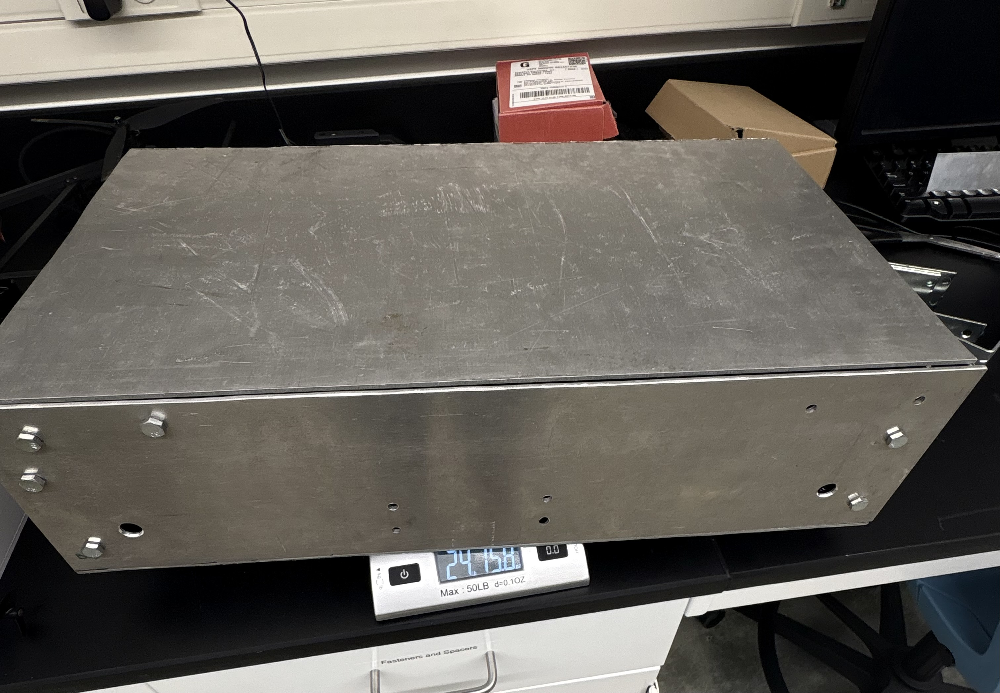

*Completed chassis with lid, ready for component mounting.*

**Motor Mounting**

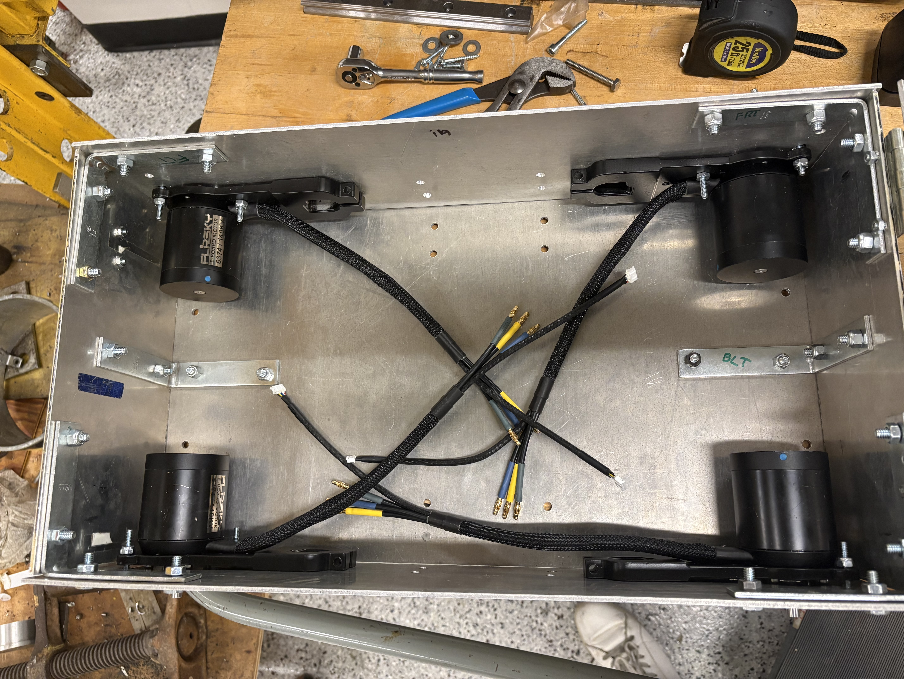

*Mounting holes drilled into the aluminum chassis with a drill press; motors bolted in place.*

**Battery Holder and ESC Mounts**

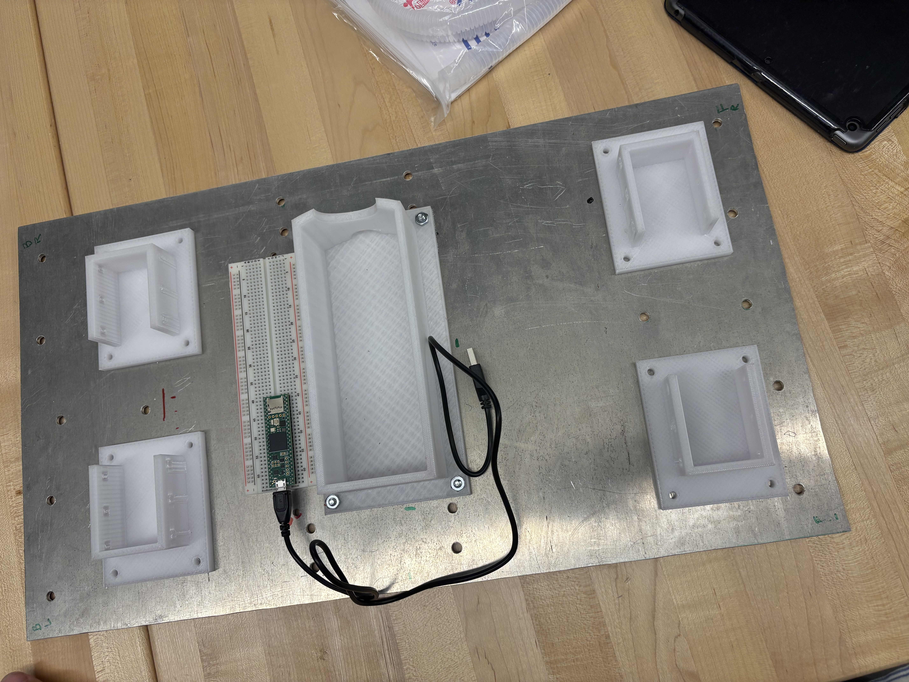

*3D-printed PETG battery holder and ESC mounts, secured to the bottom plate.*

The battery mount uses #10 bolts (24 TPI, 1.5" length) into the PETG mount. The ESC mounts use a sliding fit to seat the ESCs securely while allowing removal.

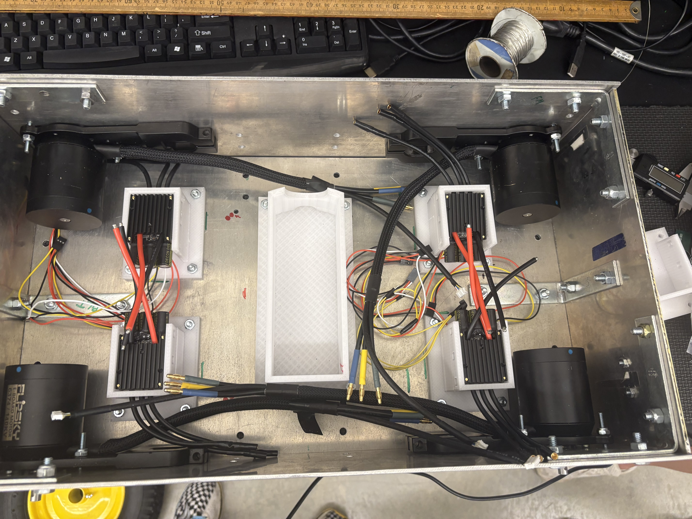

*ESC mounts installed with ESCs seated, ready for wiring.*

### Electronics and Testing

**Wiring**

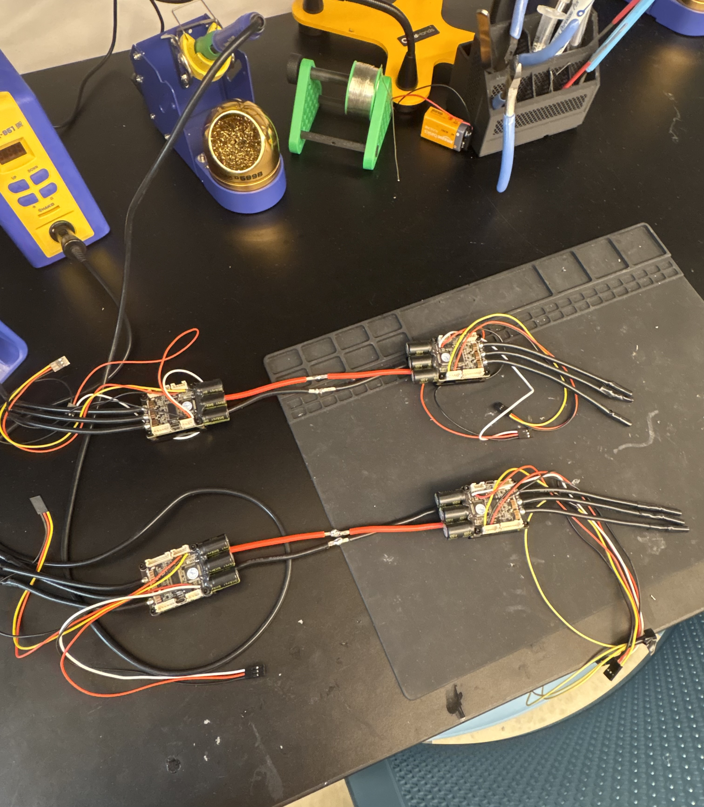&nbsp;&nbsp;&nbsp;&nbsp; 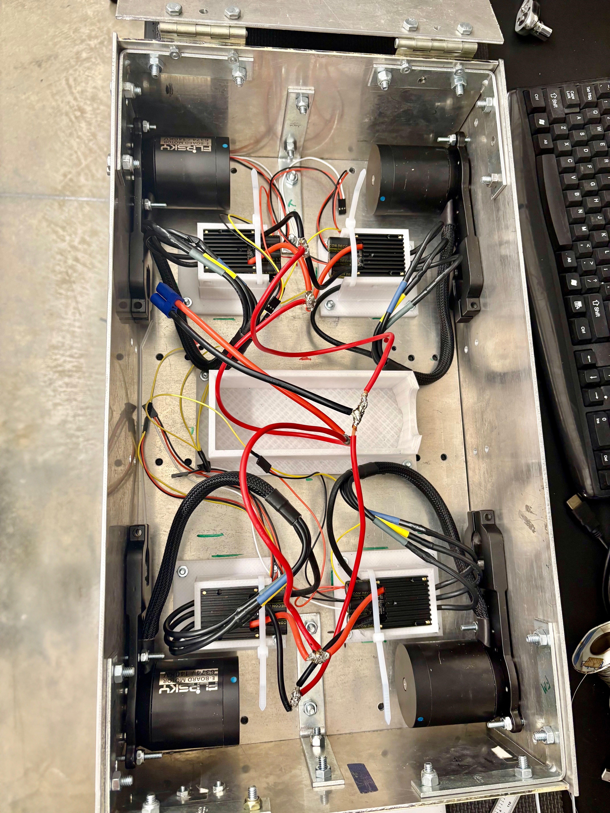

*ESCs soldered together and wired in parallel without PWM signal splitting. Simple and sufficient for this stage; planned for cleanup in a later iteration.*

**ESC Configuration**

*ESC configuration in VESC Tool.*

https://github.com/user-attachments/assets/366e0a16-83fd-4b0e-9b47-df85c3f6d8a7

*Single motor spinning during a VESC Tool test, confirming ESC configuration before full drivetrain testing.*

**Full Drivetrain Test**

All ESC ground and signal wires were tied to a single receiver to test forward and backward motion with a transmitter. This confirmed controller responsiveness across every motor before moving on to sensing and autonomy (see the demo video under Demos).
